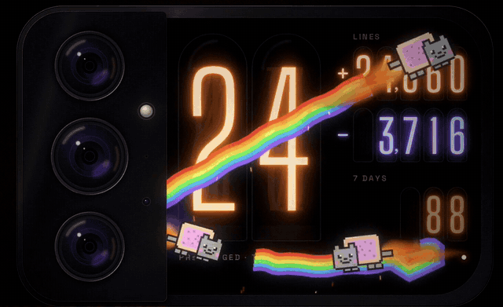
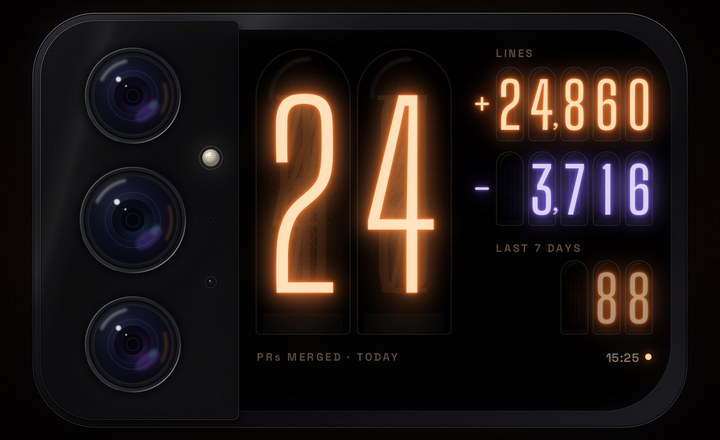
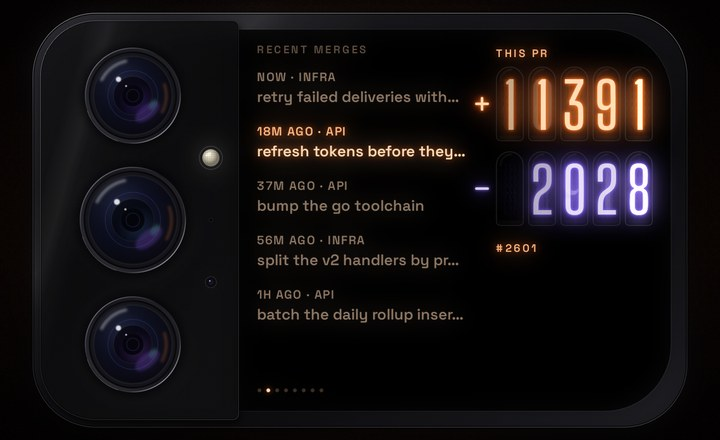
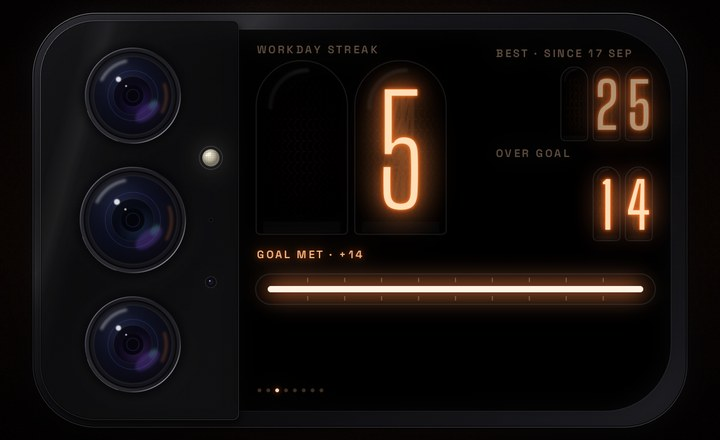
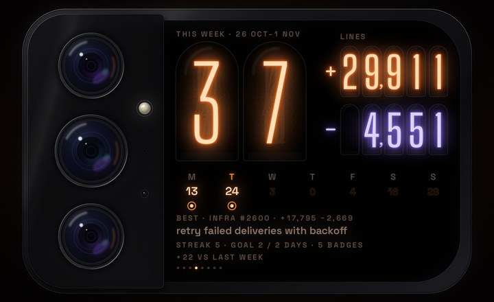
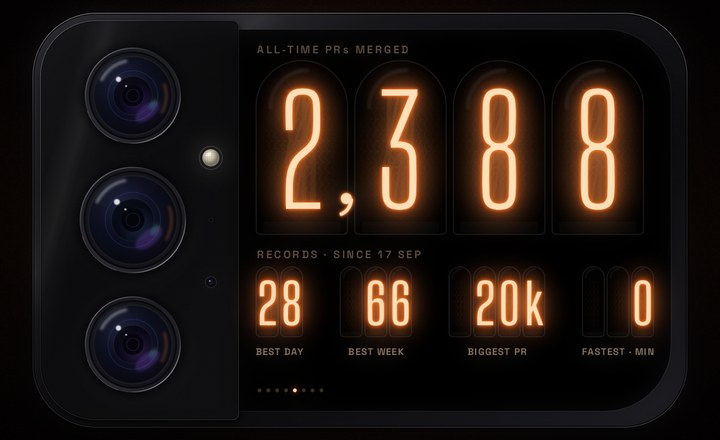
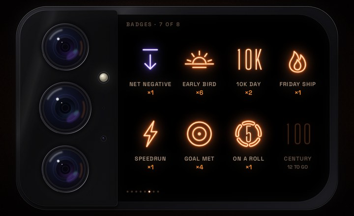
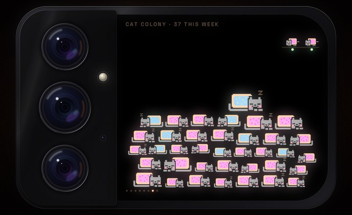
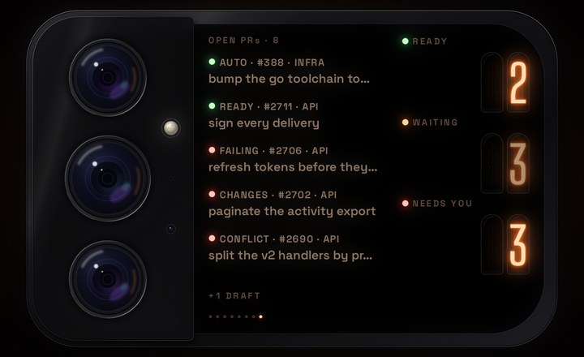

# Merged

**Your merged PRs, as glowing Nixie tubes on the back of your phone.**

Merged turns the small rear screen of the Xiaomi 17 Pro Max into a desk-counter-style instrument for your GitHub output: PRs merged today, lines added and removed, streaks, badges, and a colony of pixel cats. Every merge is an event: cats with flaming butts zoom out from under the camera, then the tubes catch fire. It runs on the stock dim always-on display, and draws 0 frames at rest.

<p align="center"></p>

<p align="center"><b><a href="demo/merged-demo.mp4">▶ Watch the 68-second demo, with sound</a></b></p>

## Screens

Swipe left and right through eight views: Today, Recent, Streak, Week, All-time, Badges, Cats, Open. Small dots at the bottom show where you are. When the rear dims it goes back to Today, so the always-on face is always Today, with the time of the last sync next to the lamp.

| | |
|---|---|
| <br>**Today.** PRs merged today in two big tubes, lines added (neon) and removed (argon violet), the last 7 days' count, and when it last synced. | <br>**Recent.** Your last 5 merges as a departures board; the banks show each one's +/−. Tap a row for its details. |
| <br>**Streak.** Your workday streak (weekends never break it), your best, how many to go today, and an IN-13-style bargraph filling towards the goal. | <br>**Week.** This week replayed day by day over last week's counts: PRs, lines, the best PR, goal days, badges, and how you're doing against last week. It plays by itself once a week from Friday 17:00. |
| <br>**All-time.** The lifetime count on an odometer, and your records: best day, best week, biggest PR, fastest merge. | <br>**Badges.** Eight achievements drawn as Nixie cathode icons, each with its own unlock animation: Net Negative, Early Bird, 10K Day, Friday Ship, Speedrun, Goal Met, On a Roll, Century. Locked ones show how close you are. |
| <br>**Cats.** A sleeping pixel cat for every PR merged this week, sized by PR and coloured by repo (with the odd rare gold or ghost one). Tap one to meet its PR, rub one for hearts and a purr, hold and drag for a laser dot. New cats fly in when you visit; open PRs that are ready wait on a shelf as kittens. | <br>**Open PRs.** Status lights for your open PRs (ready, waiting, needs you; tap a count to list just those), with an alert when one turns green or red, and a cat to fix the jewel when failing checks go green. |

## What happens when a PR merges

- **Cats, then fire.** One to five cats with rainbow trails and flaming butts roam the screen; the PR's own cat dives home under the camera and the rest burst into firework mini-cats (tap them to pop them early; pop them all for a gold one). Then the camera island strikes, a burner rail lights, and the changed digits catch fire. The bigger the PR (S, M, L, XL), the bigger the moment; small ones skip the cats and just land. See `design/FX.md`.
- **The line banks show that PR's own +/−,** then roll up to the day's totals.
- **A buzz and a chime,** following your ringer: silent or DND, nothing; vibrate, a buzz; ringer on, a buzz and an 8-bit chime with the strike. Small merges just tick. Off in quiet hours.
- **One showcase, if there's time.** The rear only stays fully on for about 10 s, so a merge gets at most one: a new badge's unlock, else the goal surge, else a rescued or changed open PR. Anything that doesn't fit waits: a badge shows NEW and unlocks when you visit Badges.
- **Missed it?** If a merge lands while the rear is dim, you get the buzz then, and the moment when you next wake the rear (or a cat peeks out under the camera: tap it to replay).
- **News.** The label after the numbers says when you hit the goal or broke a record.
- **Line counts are honest.** Lockfiles, snapshots and built JS/CSS don't count.

## Touch

- **Swipe** for the next or previous view. **Tap** what's under your finger (a row, a badge, a count, a cat), or anywhere else for the next view.
- **Double-tap Today** to replay the last merge.
- **Hold, then drag** and a cat flies out of the camera and chases your finger. Let go slowly and it flies home; fling it and it bursts into fireworks. On the cat screen it's a laser dot the cats chase.
- **Hold still for 1.5 s** to open Setup on the front screen (GitHub sign-in, Shizuku, daily goal, quiet hours). The rear says so. The launcher icon's long-press menu has Setup too.
- Each screen shows its gesture once, until you've used it. Every touch answers with a tick.

The rear screen dims 10 s after the last touch. Once it's dim, the first double-tap only wakes it. The full gesture grammar is in `design/UX-PASS.md`.

## How it runs on the rear screen

- **Routing:** Merged starts on the front screen and moves its own task to the rear display through Shizuku (`docs/rear-screen-routing.md`).
- **Always-on:** it rides the stock rear doze, so it costs about the same as Xiaomi's own rear faces (`design/REAR-AOD.md`).
- **Staying responsive:** HyperOS freezes apps on the rear while the front screen is off. A one-frame translucent activity registers Merged as the rear's foreground app, which exempts it while the rear is on (`RearPokeActivity.kt`).

Design docs: `design/SPEC.md` (the instrument), `design/V2.md` (streaks, badges, cats, week, open PRs), `design/FX.md` (the merge celebration), `design/UX-PASS.md` (gestures, the cats, merge timing).

## Battery

Built to cost about as much as a stock rear-screen face, not a live wallpaper that redraws forever and holds the screen on.

- **Idle draws 0 frames.** Frames only run while a tube is animating.
- **Merge celebration** (pixel cats with flaming butts, then fire; `design/FX.md`): 60 fps only while a merge plays, fitted inside the rear's 10 s awake window, then back to 0. No cats in quiet hours, and nothing while the rear is dim: a merge found then is parked and replayed when you wake it.
- **The cats** only move when you touch them or a merge lands: a poke, a rub, a lap, a laser chase, a few seconds of arrivals when you visit. Otherwise the colony is one static frame.
- **Ambient redraws:** a ±3px burn-in drift (checked every 5 min, and pushed to the dozing panel only when it actually moves) and a tube sweep every 15 min, which runs only while the rear is awake.
- **Refresh rate:** it requests the panel's slowest mode at rest and about 60Hz only while animating. HyperOS ignores this on the rear panel (it stays at 120Hz), so this only matters on the front screen.
- **Always-on:** Merged uses the stock rear doze. About 16 s after the rear wakes, Xiaomi's DozeService dims the panel into self-refresh (DOZE_SUSPEND). Merged stays on top, so its last frame shows at the light-sensor doze brightness (1–35 nits), the same way the stock face does. While dozing it doesn't animate. Number changes reach the panel through a 500 ms DRAW wake lock push. The rear still goes black on the stock rules: pocket, dark room, or 90 s after unlocking. See `design/REAR-AOD.md`.
- **Network:** it polls GitHub only while visible (HyperOS freezes Merged while the phone is idle, so it catches up when you next use the phone):
  - every 2 min normally;
  - every 15 min in quiet hours (23:00 to 07:00 by default);
  - every 45 s while a merge looks imminent (a PR with auto-merge on, or one that went ready in the last day) or a PR that failed in the last day is waiting for a fix;
  - right away when the rear wakes and the last sync is over a minute old.

  Each poll is one GraphQL call (about 1 point of the 5000/h budget), published before anything slower. The open-PR search is a second call, made at most every 5 min; in between, PRs with failing checks are re-checked with one cheap `nodes()` call. The generated-file check runs once per new PR. The streak history is backfilled week by week, only until the streak's first missed workday.
- **Buzz and chime:** a fresh merge vibrates (a tick for S, 2–3 pulses for M and up; XL adds a long one) and, with the ringer on, plays a short 8-bit chime (`design/sfx/make_sfx.py`). Badges get a sparkle, cats a mew. Silent mode or Do Not Disturb: nothing. Vibrate mode: buzz only. Never in quiet hours. HyperOS drops app vibrations tagged as notifications, so Merged checks the ringer itself. Touch answers (ticks, the purr, pops) follow the system's touch-vibration setting.

To check idle cost: `adb shell dumpsys gfxinfo co.tryterra.merged reset; sleep 60; adb shell dumpsys gfxinfo co.tryterra.merged | grep 'Total frames'`. This should print 0 when no merge happened.

## Data

`GitHub.kt` runs a single GraphQL search for `author:@me is:pr is:merged merged:>=<6 days ago, local midnight>`, plus `issueCount` for year-to-date and lifetime. A PR counts as fresh if its id wasn't in the previous poll (`seen`, in prefs) and it merged less than 6h ago.
- **First run:** nothing celebrates.
- **Several at once:** one combined moment (`MERGED · 3 PRs`).

## Sign-in

Setup (on the front screen) offers two ways:

1. **Sign in with GitHub** uses Device Flow. It needs an OAuth App client id at build time. Create the app at github.com/settings/applications/new: any homepage and callback URL will do, and you must tick **Enable Device Flow**. Then add `githubClientId=Iv1.xxxx` (or `Ov23…`) to `android/local.properties` or `~/.gradle/gradle.properties`. The scope is `repo`, the only OAuth scope that lets search see private-repo PRs. If an org restricts OAuth apps, an owner has to approve the app for that org.
2. **Paste a token:** a classic PAT with `repo` scope. This works with no OAuth app at all.

The token is stored AES-GCM-sealed with an Android Keystore key (`Vault.kt`).

## Build, test, install

Unit tests (streaks, records, quiet hours, badge rules and progress, open-PR status, generated-file filter, cat pile layout and coats): `./gradlew :app:testDebugUnitTest`.

```sh
cd android
./gradlew assembleDebug        # or assembleRelease (debug-signed, no adb test hooks)
```

**Emulator** (an AVD `rear976` at 976×596; drive it with debug-build hooks, which only `adb shell` can reach):

```sh
B='adb shell am broadcast -f 32 -a co.tryterra.merged.DEBUG -p co.tryterra.merged'
$B --ei cutout 296                 # pretend the camera covers the left 296px
$B --es token "$(gh auth token)"   # real data
$B --es demo big|quiet|zero|off    # canned days
$B --ez season false               # no seasonal cat coats
$B --ei merge 50|500|2000|6000     # fake a merge: S / M / L / XL (shown over real data until the next poll)
$B --es show goal|badge:EARLY_BIRD|open|rescue|recap|cats|arrive|peek|missed|hints|screen:STREAK   # a showcase, a cat trick, a screen
$B --ei goal 3                     # daily goal
$B --es badges reset               # forget earned badges
```

**Phone:** `adb install -r android/app/build/outputs/apk/debug/app-debug.apk`. If your ROM blocks `adb install` (some HyperOS CN builds do), use `scripts/install-apk-hyperos.sh <apk>`. Then:

1. Start Shizuku. It runs in adb mode, so restart it after every reboot (`docs/shizuku-rish.md`).
2. Open Merged and grant Shizuku.
3. Sign in.
4. Tap **Start**. It launches on the front screen and moves itself to the rear (`docs/rear-screen-routing.md`).


## Repo layout

| Path | What |
|---|---|
| `android/` | The app (Kotlin, one Canvas-drawn view, no UI toolkit, no dependencies beyond Shizuku) |
| `design/` | Specs, mockups, the effects prototype and the chime generator |
| `docs/` | Rear-screen routing and Shizuku notes, README media |
| `demo/` | The demo video, and `demo/src/` with the scripts that made it (phone capture, graphics, the synthesised soundtrack, the edit) |
| `scripts/` | APK install helper for ROMs that block `adb install` |

## Credits

- Fonts: Big Shoulders Display and Space Grotesk, under the SIL Open Font License (`android/app/src/main/assets/fonts/`).
- The pixel cats are original artwork, a homage to Nyan Cat. The chimes, soundtrack and sound effects are synthesised from scratch (`design/sfx/`, `demo/src/make_audio.py`).

## License

MIT, see `LICENSE`. The bundled fonts keep their own SIL Open Font License.
